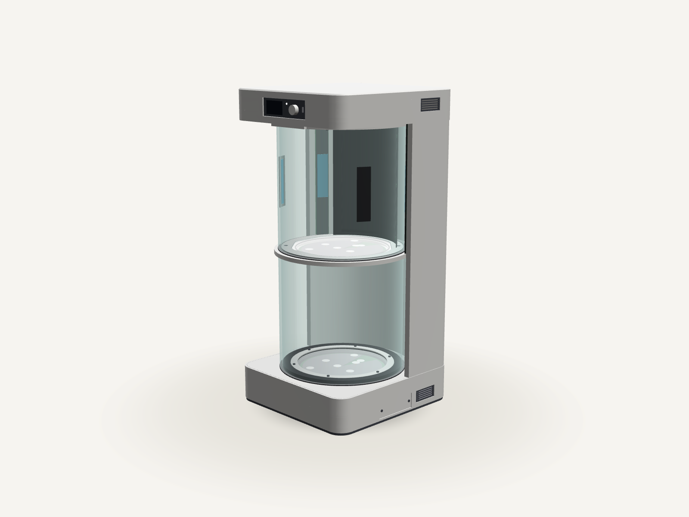

# The machine in 3D

This is the Desktop Replicator's CAD model, turned round, pulled apart and cut open in your browser. Point at a part to see what it is. Click it to read more and jump to the guide that explains it.

The model is drawn by the project's own software, part by part, from the same numbers that fill the rest of this handbook. It is a design, not a photograph: no part shown here has been measured, and several mechanisms are not designed yet (see the list under the viewer).

<label>Explode <input id="cad-explode" type="range" min="0" max="100" value="0"></label><label>Cut open <input id="cad-cut" type="range" min="0" max="100" value="100"></label><label class="cad-check"><input id="cad-glass" type="checkbox" checked> Glass</label><button type="button" class="cad-btn" data-view="iso">Iso</button><button type="button" class="cad-btn" data-view="front">Front</button><button type="button" class="cad-btn" data-view="side">Side</button><button type="button" class="cad-btn" data-view="rear">Rear</button><button type="button" class="cad-btn" data-view="top">Top</button><button type="button" class="cad-btn" id="cad-reset">Reset</button>

<aside class="cad-side">

Assemblies<ul class="cad-legend"></ul>
</aside>

Drag to turn, scroll to zoom, right-drag to move. The Explode slider pulls each assembly apart along the stack. Cut open slices the front half away. Untick an assembly to hide it, or click its name to fade the rest.

## What you are looking at

One axis runs from the plinth at the bottom to the head at the top. The stack is the one described in [Architecture](architecture.html#three-zones).

| Zone | What it holds | Datasheet |
|---|---|---|
| Plinth | Base, boards, power supply, the lower acoustic plate | [S08 Control and firmware](subsystems.html#s08-control-and-firmware), [S04 Acoustic array](subsystems.html#s04-acoustic-array) |
| Storage bucket | A fixed glass tube, the same size as the build tube, for feedstock | [S02 Storage and release](subsystems.html#s02-storage-and-release-plinth) |
| Mid-plane | The slot and the cassette: a flat wafer in a hard ring that reflects sound and lifts out by hand | [S03 Mid-plane interface](subsystems.html#s03-mid-plane-interface) |
| Build cylinder | The lifting glass tube, the rear liner and the laser ring | [S01 Chamber and stack](subsystems.html#s01-chamber-and-stack-topology), [S06 Optical ring](subsystems.html#s06-optical-tomography) |
| Head | The upper acoustic plate, three gap actuators, the display | [S05 Gap lock](subsystems.html#s05-gap-actuator-and-resonance-lock) |
| Rear tower | The rails the head rides on, the cooling duct, the laser strips | [Desktop Replicator](desktop-replicator.html#the-enclosure) |

## How the model is made

The twin generates the model from a parametric description, so a change to a number in the design redraws every part that depends on it. The same description writes an exact solid model (STEP files) and the mesh in this viewer. The geometry checks confirm that the solids close, that parts do not collide and that the mesh matches the exact solids. Those checks show the model is self-consistent. They do not show that the machine works ([Digital twin](digital-twin.html#what-each-kind-of-check-proves)).

The viewer shows the current default build, called Rev S in the design files. It is the first model with the storage bucket and the mid-plane cassette directly under the build chamber, as the [architecture](architecture.html) describes. Part descriptions are written for this page. Sizes are the bounding box of each part in millimetres, read from the mesh.

## What the model does not settle

- No acoustic simulation covers the bucket, the hard ring, the gate seam or the mesh variant of the cassette yet (*Open*).
- The mechanisms for the transfer gate, the cassette's seats, the rim contact and the actuator brackets are not designed (*Open*).
- The thermal split between the plinth and the chamber floors is not yet met in the lumped model (*Simulated*).
- The cooling and wiring paths are drawn as space claims. Cables are not shown.

Related: <a href="architecture.html">Architecture</a> · <a href="subsystems.html">Subsystems and interfaces</a> · <a href="desktop-replicator.html">Desktop Replicator</a> · <a href="digital-twin.html">Digital twin</a>

