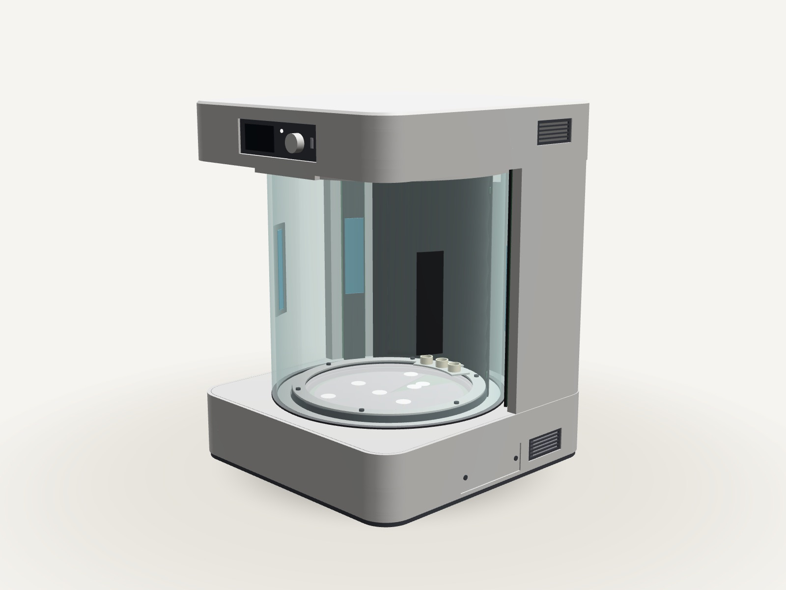
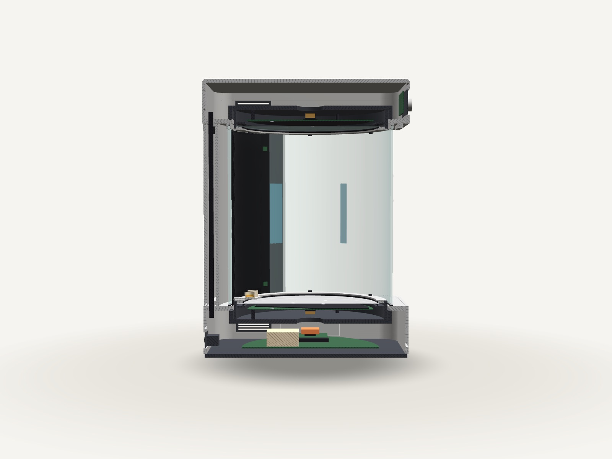
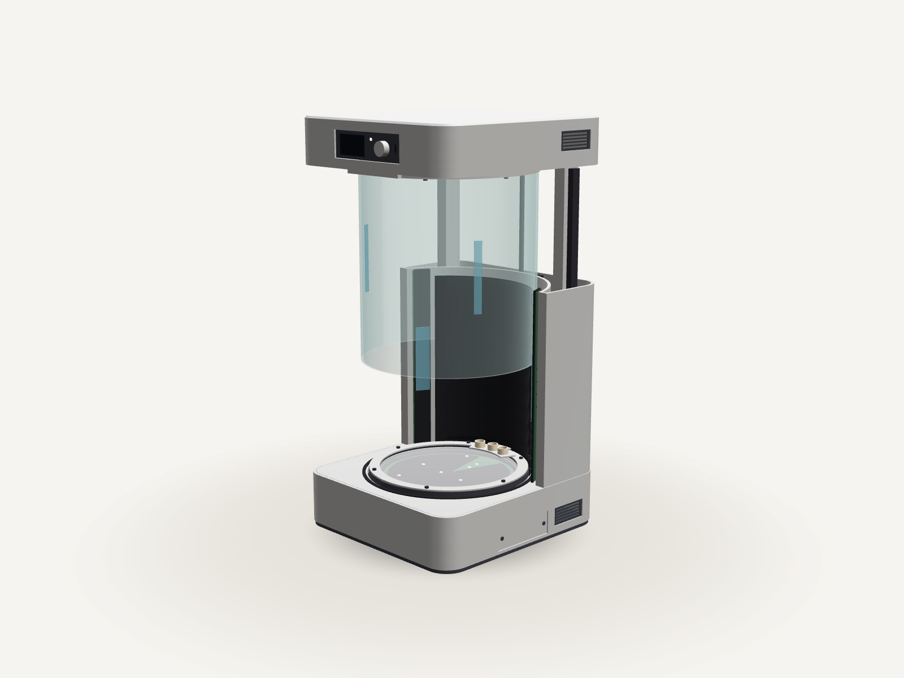

# Desktop Replicator

The Desktop Replicator is the machine we are designing to build first: a benchtop chamber about the size of an espresso machine. Inside, two vibrating glass plates hold and move small amounts of material in mid-air, and a ring of low-power lasers watches. Every figure carries an [evidence label](status.html#evidence-labels).

CAD render. The round plate on the chamber floor is the lower acoustic wafer; an identical one faces it from the head. The crucibles at the rear hold feedstock.

<strong>Which build this page describes.</strong> The CAD default is now Rev S, the unified stack: a fixed glass storage tube directly under the build chamber, a lift-out cassette between them, and three gap actuators in the head. <a href="cad-3d.html">See it in 3D.</a> Sections below that describe the crucible tray, the rear bottle store and the bottle weighing still describe the Rev F2 layout, which remains a build option. They are being brought in line with Rev S.

## At a glance

| | Value | Evidence |
|---|---|---|
| Outside size | {{c:desktop_geometry.envelope_mm|x}} mm | Derived from the CAD model |
| Mass | {{c:desktop_geometry.nominal_mass_kg}} kg nominal | Derived from model densities |
| Work chamber | One chamber, {{c:desktop_geometry.gap_mm}} mm between the plates, no holes in floor or ceiling, closed by a glass cylinder that lifts with the head | Design decision |
| Acoustic plates | Two undrilled Ø{{c:desktop_geometry.wafer_diameter_mm}} × {{c:desktop_geometry.wafer_thickness_mm}} mm borosilicate [wafers](glossary.html) ({{c:desktop_geometry.wafer_material}}), Ø{{c:desktop_geometry.clear_glass_diameter_mm}} mm free to vibrate | Design decision |
| Sound sources | {{c:desktop_geometry.ports_per_plate}} small [piezo](glossary.html) discs (PZT-8, Ø{{c:desktop_geometry.pzt_diameter_mm}} × {{c:desktop_geometry.pzt_thickness_mm}} mm) bonded behind each wafer, 12 in total | Design decision |
| Drive tones | {{c:desktop_geometry.comb_tones_hz|khz}} kHz. One tone lifts; the set of five senses and shapes | Design decision |
| Lift | One 160 kHz tone on the full {{c:haptic_pzt.bridge_rail_v}} V supply lifts about 1.2 times a foam bead's weight. Five tones sharing the supply lift about 7 % | Simulated |
| Acoustic sensing | The same 12 piezo discs listen while they drive. A 16-bit converter ({{c:haptic_pzt.adc_fallback_mpn}}) reads them, because the 1-bit converter failed its simulated test | Simulated |
| Optical sensing | {{c:mosquito_smi.total_ommatidia}} laser diodes at {{c:mosquito_smi.laser_wavelength_nm}} nm that each double as their own detector, looking through the glass | Simulated |
| Electronics | {{c:clock_and_bus.pcb_count}} circuit boards and one plug-in compute card | Design decision |
| Controller memory | Under {{c:cadence_brain.cadence_sparse_max_kb}} kB for the on-board pattern network | Design target |
| Electrical power | 17.0 W with the first compute card, 22.5 W with the second, every source driven with its worst pattern | Derived from candidate-part datasheets |
| Feedstock | Open crucibles for powder, liquid and seed parts inside the chamber, fed from a store of three bottles on weigh cells | Design decision; store Derived from CAD |

A smaller configuration, called `boro12`, fits Ø{{c:desktop_geometry.boro12_reducer_wafer_mm}} mm wafers {{c:desktop_geometry.boro12_gap_mm}} mm apart into the same frame. It uses tones of {{c:desktop_geometry.boro12_comb_tones_hz|khz}} kHz, so first experiments can run on a small, cheap pair of plates.

## How it works

**Two plates make the field.** Each wafer is held only at its rim, in a soft silicone ring. Six piezo discs glued to its back set the whole plate ringing, and the plate sends ultrasound into the chamber. Two facing plates make standing pressure patterns with quiet pockets. A small bead or droplet is held in a pocket. Changing the strength and timing of the twelve drive signals moves the pockets. The physics is in [Acoustics](acoustics.html).

**The plates also listen.** The piezo disc that pushes on the glass is pushed back by it. The electronics measure that push-back on the same two wires while driving, so every source is also a microphone. Objects in the chamber change what comes back. That is how the machine senses what it holds.

**A ring of lasers watches.** {{c:mosquito_smi.total_ommatidia}} small laser diodes look across the chamber from two strips beside the rear tower. Each beam crosses the work volume, hits a reflective strip at the far side and returns into its own laser, where a built-in photodiode picks up the disturbance. A bead that blocks the beam shows as a steady drop. Sound crossing the beam shows as a ripple, because pressure changes how much air bends light. So one cheap part gives a shadow image and an optical measurement of the sound field. This is [self-mixing interferometry](optics.html#coherent-self-mixing-optical-readout).

**One clock keeps everything in step.** A single {{c:clock_and_bus.xin_hz|mhz}} MHz oscillator feeds every controller through matched traces, and one shared signal marks the start of each frame. Boards may differ by at most {{c:clock_and_bus.sync_skew_max_ns}} ns, so drive signals and sensor readings share a time base.

**A small network picks the drive pattern.** A plug-in card holds Prime, the project's model built on the Cadence library. Given the sensed state and a target, it settles on a set of drive strengths and timings. The settle target is {{c:cadence_brain.rp2350_settle_target_ms_range|range}} ms (Design target); instruction counts give 4.4 to 6.1 ms (Derived). It is trained on a workstation and copied to the card ([Cadence, memory and wave compute](cadence-memory.html)).

Section through the centre. Top and bottom: wafer, piezo discs and the board that drives them. Bottom: backplane, power and compute card. Left: the hollow tower that carries the head, the laser strips, the cabling and the cooling air.

## The enclosure

Head raised for loading. The glass cylinder and the upper plate travel with the head.

The body is a rounded-square base and head joined by a hollow rear tower, which carries the head, covers the laser strips and acts as a duct.

- **Glass cylinder.** A stock borosilicate glass cylinder ({{c:desktop_geometry.glass_cylinder_id_od_mm|x}} mm inside and outside diameter) hangs from the head and closes the chamber on all sides. It shields levitated material from room draughts. In simulation it raises the sound pressure by {{c:desktop_geometry.chamber_gain_closed_gap_median|range}} times over an open chamber.
- **Static charge.** A foam bead that rubs glass picks up charge. At about {{c:electrostatics_and_matter_loop.eps_r0p5mm_image_clamp_1g_pc}} pC a 1 mm bead sticks to the glass with a force equal to its weight. So the plates and the cylinder need a slightly conductive, grounded surface, and the chamber air a relative humidity of {{c:electrostatics_and_matter_loop.chamber_ambient_rh_pct_range|range}} %, to keep the charge under {{c:electrostatics_and_matter_loop.max_bead_charge_pc}} pC (Derived). No surface treatment has been chosen.
- **One coating, three possible jobs (Open).** A clear, slightly conductive, grounded coating would bleed away static charge and keep radio-frequency fields inside. Cut into driven patches, it would later turn a passive wall into a controlled one ([what more wall buys](architecture.html#what-more-wall-buys)). The lasers must still see through it.
- **Lifting head.** To load the chamber, the head, the glass and two guide posts rise {{c:desktop_geometry.lift_stroke_mm}} mm on rails in the tower. The moving mass is {{c:desktop_geometry.lift_moving_mass_kg}} kg, partly balanced by springs, and the open machine is {{c:desktop_geometry.envelope_open_height_mm}} mm tall. The upper plate moves with the head, so calibration is repeated after every opening.
- **Interlock.** A hardware safety switch sits in series with the bridge-enable supply and the laser supply. Head up: drive outputs high impedance and lasers off, so the machine can listen but not transmit. The firmware also refuses to drive. Clear glass does not block laser light, so it is not an enclosure around the laser beams. The laser class is Open ([S11](subsystems.html#s11-thermal-and-safety)).
- **Air sensors.** Two temperature sensors measure the chamber air, because a few tenths of a kelvin spoil a calibration.
- **Cooling.** Air enters through louvres beside the power supply, rises through the tower and leaves through louvres in the head. None passes through the work chamber.
- **Service.** A side hatch reaches the compute card. Power and USB-C are on the rear panel. A small display and a rotary knob are on the head.

The model passes its geometric checks (closed solids, clearances, no collisions, mesh matching exact CAD). They show the model is self-consistent, not that the machine works ([Digital twin](digital-twin.html)).

## Electronics

Two identical field boards sit directly behind the wafers. The third is the backplane in the base.

| Board | What is on it |
|---|---|
| Head board, two identical (Ø172 mm) | One RP2350B microcontroller, six drive stages ({{c:haptic_pzt.hbridge_driver_mpn}}), receive protection (BAT54S), four {{c:haptic_pzt.adc_fallback_mpn}} converters for the piezo discs, fast comparators (TLV3501) for the laser ring, and one spare piezo disc that touches nothing |
| Backplane (Ø188 mm) | The 12 MHz clock and its distribution, power conversion from USB-C, rear connectors and the socket for the compute card |
| Compute card (M.2 form factor) | Card 1: an RP2350B running Prime. Card 2: an optional FPGA module. Card 3 is reserved for an optical core |

**Why the electronics sit behind the wafer.** A piezo disc of this size has a capacitance of about {{c:haptic_pzt.c0_nominal_pf}} pF. A cable to a remote amplifier would add far more and swamp the small received signal. A controller millimetres away keeps the added capacitance under {{c:haptic_pzt.max_trace_cap_pf}} pF.

**Why not a 1-bit converter.** The first design read each disc with a comparator, which only answers "higher" or "lower", {{c:haptic_pzt.sigma_delta_fs_hz|mhz}} million times a second. That is {{c:haptic_pzt.osr}} times faster than signals below {{c:haptic_pzt.ultrasonic_bw_hz|khz}} kHz need, for an estimated {{c:haptic_pzt.enob_range|range}} bits. It had to keep {{c:haptic_pzt.sfdr_gate_min_db}} dB between the wanted tones and the largest false one. A bit-exact simulation reached {{c:haptic_pzt.sfdr_simulated_dbc}} dB, so it failed. A 16-bit converter ({{c:haptic_pzt.adc_fallback_mpn}}) takes its place on footprints already there ([details](compute-control.html#receive-reading-each-disc-while-it-drives)). The laser ring is still read through a fast comparator.

**Why a spare piezo disc.** The capacitance of the ceramic drifts by about {{c:haptic_pzt.c0_tempco_pct_per_c}} % per degree. A disc not attached to the plate drifts the same way but hears nothing, so subtracting its signal removes the drift.

All part numbers are candidates. Their electrical values are typical figures and must be re-read from current datasheets before the design is frozen. Stock and price have not been checked.

## Heat

With the first compute card the machine gives off an estimated 17.0 W when every source is driven with its worst pattern: 10.9 W in the drive stages and 2.0 W in the {{c:mosquito_smi.total_ommatidia}} lasers. With the second card the total is 22.5 W. The warmest internal air is 12.7 K above ambient against a 20 K limit. This is an eleven-node estimate from candidate-part datasheet values, not a flow simulation (Derived).

One rule shapes the layout: **the chamber floor must not be warmer than its ceiling.** Air heated from below turns over, and moving air drags on anything levitated in it. In a chamber {{c:desktop_geometry.gap_mm}} mm tall, a floor a few thousandths of a kelvin warmer than the ceiling is estimated to start that motion. The base holds most of the electronics, so without care the floor would be the warm side. With thermal pads on the lower board only, the model predicts a ceiling wafer 1.9 K warmer than the floor wafer (Derived). How fast the air would move, and whether that drag matters next to the holding force, is Open.

## Material in and out

Feedstock sits in three open crucibles on a tray at the back of the chamber, just clear of the lower wafer: one each for powder, liquid and seed parts. A store of three 500 mL stock bottles on weigh cells feeds liquid through a reversible metering pump and one Ø1.6 mm line that rises between the wafer socket and the glass (Derived from CAD; pump and cells not selected). Powder and seed parts are dosed by hand with the head raised. See [S02](subsystems.html#s02-storage-and-release-plinth).

The intended cycle: the machine finds material in a crucible, lifts it with sound, carries it to the build position and joins it there. Unwanted material is carried back to a crucible.

Three points about this cycle are open.

1. **Joining.** Material is to be joined by the fields themselves (sound pressure, heat, a change of state). No joining recipe has been simulated end to end ([Manufacturing](manufacturing.html#consolidation)).
2. **Taking material away.** Removing joined material means breaking bonds, which replaying a reversed holding pattern does not do. That earlier shortcut was wrong and has been removed from the code. The simulation and the twin now model removal as absorption at a measured resonance, then transport to a crucible (Simulated; [why](matter-loop.html#why-reversing-a-holding-pattern-removes-nothing)).
3. **Mass accounting.** Mass in the part plus mass in the store should stay constant through a build, read on the weigh cells. No threshold is fixed, and no whole-build mass balance has been simulated.

## What gets checked before anything is bought

The plan has no disposable test rigs. The front-end electronics, the plate response and the optical readout are checked in simulation against the full chamber. The assembled machine is then calibrated in place with removable Ø1 to 2 mm spheres and the crucibles.

Hardware may be released for purchase only when five things exist: a frozen design revision, a priced parts list, exact CAD with a thermal budget, passed simulation gates and a fixed acceptance procedure ([Current state](status.html)). Three release gates currently fail in simulation: the plate response cannot be predicted offline, the drive cannot hold a solid bead, and the field leaves too many unwanted traps ([Acoustic bodies](acoustics.html#known-limits)). The 1-bit converter test also failed and is answered by the 16-bit converter.

Ordering parts or contacting suppliers also requires explicit approval from the operator.

## Optional and experimental features

**Spiral launcher.** The wafers have no holes, so the model can add a twelve-arm spiral of copper or indium tin oxide on the glass, about {{c:dissolve_and_toroidal.borofloat_chiral_spiral_trace_thickness_um}} µm thick and fed from the rim. It is meant to launch short doughnut-shaped electromagnetic pulses. It is off by default, and whether it makes a useful pulse in this chamber is Open ([Optics](optics.html#toroidal-optical-pulses)). The film is solid metal to microwaves and almost nothing to sound, so no filter part is needed (Derived in principle; the film's effect on this plate is Open).

**Small pulsed coil at a crucible.** Large coils across the whole chamber give almost no force. A compact ring coil of {{c:dissolve_and_toroidal.compact_toroid_collar_id_mm_range|range}} mm round one crucible is a candidate for softening or breaking down material during recovery. It is not in the CAD model ([Electromagnetics](electromagnetics.html)).

## What this design replaced

These are the earlier whole-machine baselines. Parts and methods removed from the current design are logged in [Subsystems and interfaces](subsystems.html#deleted-parts-and-retired-baselines).

| Earlier baseline | Status | Why it was retired |
|---|---|---|
| P0: a 4 × 4 array of 40 kHz ultrasonic transducers | Historic. Kept only as a software regression case | A separate rig that taught nothing about plate acoustics or self-sensing |
| HA-0 Rev C: Ø150 mm wafers drilled for a Ø12 mm central pipe, with single-purpose test coupons | Historic | The hole weakened the glass and removed the most useful part of the aperture. Coupons cost bench time and were then discarded |
| Hand-applied UV adhesive joining | Historic | Needed a person inside the loop for every joint |
| Bolt-clamped high-Q horn transducers and a fixed 20 ms frame clock | Parked | Narrow-band sources cannot play several tones at once or listen while driving |
| A floor-standing column with three plates: a build chamber on top and a hidden storage chamber below, sharing a two-faced middle plate | Earlier design study | The reason is not recorded. Storage below the build chamber is kept in the [two-zone layout](architecture.html#three-zones) |
| Large wound coils behind each plate, meant to lift metal and carry feed up a central hole | Retired | In simulation, coils that far from the work give almost no force ([Electromagnetic control](electromagnetics.html#what-does-not-work-large-coils-across-the-chamber)) |
| Three piezo elements feeding a horn and a printed ceramic sponge behind a perforated metal plate | Retired | Above about 12 kHz a thin glass plate already radiates well, so discs are bonded straight onto bare glass (Derived) |

## Prototype, not destination

The microcontrollers, comparators and discrete lasers are scaffolding that can be bought now. The long-term design replaces the twelve wired sources with a [surface switched by light](acoustics.html#long-term-direction) and the digital controller with wave-based computing. [Architecture](architecture.html#long-term-architecture-and-the-desktop-replicator) sets the two side by side, and the [interface control matrix](subsystems.html#interface-control-matrix) lists the interfaces that allow each swap.

## Open questions

| Question | Who answers it |
|---|---|
| Does the 16-bit converter resolve the echo to {{c:haptic_pzt.sfdr_gate_min_db}} dB with five tones present? | Electrical design and simulation |
| What drive voltage, tones, source size and bead density reach a holding pressure for a solid bead on the Ø{{c:desktop_geometry.wafer_diameter_mm}} mm wafer? | Simulation, then design |
| Does the head return to the same position after each lift, closely enough to keep a calibration? | CAD tolerance study, then the assembled machine |
| Which surface treatment bleeds static charge from the glass without disturbing the lasers or the sound? | Materials selection, then the assembled machine |
| Does the larger piezo disc adopted for a first levitation keep pattern control? | Simulation |
| How large is the buoyant air motion for a given floor-to-ceiling temperature difference? | Simulation |
| Does the laser amplifier pass the highest drive tone? A single stage with a gain of 200 would roll off at about 100 kHz | Circuit design |
| What joins material without adhesive, and what removes joined material on the real plates? | Process simulation |
| Which vendors can supply the custom piezo discs and at what tolerance? | Procurement, after approval |

## Where the design lives

The parametric model, parts list, drawings and exported geometry are generated by the [digital twin](digital-twin.html) (`fieldc desktop` commands). Numbers shared by firmware, simulation and CAD are held in one constants file. The [Insight register](insights.html) lists the findings that shaped this design.
